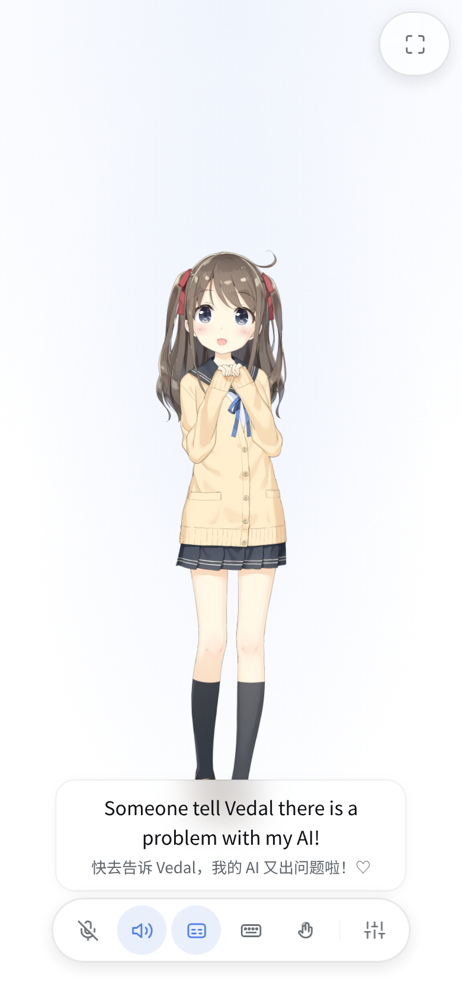

# dsh-live2d-voice

DSH 插件：在会话视图里新增 **Live2D** tab——Live2D 角色随对话实时开口说话（口型同步 + 表情切换 + 字幕），AI 回复经 Fish Audio TTS 流式合成语音推送到浏览器播放；🎙 连续语音输入（本地 VAD 分句 + 火山引擎 ASR）让你全程免键盘对话。

<p align="center">
  
</p>

能力总览：

- 🎭 **Live2D 角色舞台**：Cubism 4 模型（pixi.js v7 渲染），说话时 `ParamMouthOpenY` 随音频 RMS 包络驱动口型，句级情绪标签切换表情
- 🔊 **流式语音**：LLM 回复边生成边按句合成（Fish Audio，44100Hz PCM），SSE 推送、浏览器端队列播放；断句 / abort 与模型流同步
- 🎙 **连续语音输入**（v0.2.0 → 流式化）：浏览器本地 VAD 分句 → **实时推流**（火山 `bigmodel_async` 双向流式 + nostream 二遍，边说边出字幕，说完 ≈0.6s 定稿）→ 自动提交对话；支持说话打断（barge-in）与扬声器回声防护；`asrMode: nostream` 可切回一次性整句识别（25 语种含日语）
- 💬 **双语字幕**：用户与 AI 台词均显示（14s 淡出），可一键隐藏；角色台词自动翻译成目标语言（v0.3.0，走会话同款 LLM，一行原文一行译文）
- 🎭 **多模型目录**（v0.3.0）：`modelPath` 指向多个角色子目录时 ⚙ 出现模型切换器，即选即换
- 🗂 **per-workspace 覆盖**（v0.3.0）：按工作区路径覆盖音色/模型/语言等表现层配置，同一插件多工作区多角色
- ⛶ **沉浸全屏**（v1.1.0）：一键全屏成为角色终端；全屏+语音监听时自动保持屏幕常亮（Wake Lock）——把旧手机放在桌上当角色挂机
- 👁 **视线追踪**（v1.1.0 实验性）：前置摄像头注视追踪，角色会看着你的脸（MediaPipe FaceLandmarker，经插件路由懒加载，手机无需科学上网；⚙ 可开关）
- 📸 **看向你**（v1.1.0 实验性）：模型可调用 `look_at_user` 工具从前置摄像头拍一张照片并真正"看到"你（仅在该会话的 Live2D 视图打开时存在此工具）
- 📱 **陀螺仪视差**（v1.2.0 实验性）：倾斜手机，角色的头部/身体/视线与位置随之偏移——"角色在屏幕玻璃后面"的立体错觉（开启时以当前握持姿势为正中；⚙ 可开关）
- 🚪 **独立入口**（v1.3.0，v1.4.1 起 GUI 的 Live2D 界面有"独立入口"按钮直达）：`/live2d-voice/app?session=<id>`——无 GUI 界面的单会话角色页，自带全部能力（语音/字幕/翻译/设置/全屏/实验特性）；冷会话自动经会话控制器恢复（带完整 preset），支持 steer 插话
- 🗂 **会话选择页**（v1.6.0）：`/live2d-voice`——列全部会话（标题/目录/运行状态/相对时间），一键新建直达角色页；配套无头 API：`POST /live2d-voice/session`（幂等创建/领养会话）、`GET /live2d-voice/sessions`（会话列表），独立启动器与 exe 打包的基石
- ⌨ **键盘输入**：在 Live2D 页直接对话（走 GUI 会话通道，冷会话自动创建/resume agent）
- 🔊 **音色库**：⚙ 面板与系统设置里的音色入口直连 Fish Audio 公共音色库——关键词全库检索、按语言/标签筛选、逐条试听（优先放作者预渲染样本，零配额），选中即写回 `voiceId`
- 🔇 **静音开关**：只看口型不听声

## 安装

```bash
# 在 DSH profile（如 ~/.dsh/profiles/web）里
pnpm add dsh-live2d-voice        # 或 link: 本地开发
# package.json 的 dsh.profile.bundles 追加 "dsh-live2d-voice"
pnpm install && sv restart dsh   # 重启 dsh 生效
```

要求：DSH ≥ 对应 0.1.5-rc.3 host 包系列；浏览器需 WebGL。

## 配置

配置文件：`<DSH_HOME>/live2d-voice.json`（如 `~/.dsh/live2d-voice.json`）。保存后刷新页面即生效（音色也可在 ⚙ / 系统设置的**音色库**里挑，会写回该文件）。

```jsonc
{
  // 角色模型目录：包含 .model3.json 的文件夹（Cubism 4）
  "modelPath": "/root/.dsh/live2d-voice-models/haru",

  // Fish Audio 音色 id（界面里从音色库挑；下方预设表是默认值与示例）
  "voiceId": "0c7771ca5910484e8a4933068017fcee",

  // TTS 模型名
  "ttsModel": "s2.1-pro-free",

  // Fish Audio API key：内联数组（多个 key 自动轮询：401/402/429 时切换下一个）
  "apiKeys": [],

  // 情绪标签 → 模型表情（Haru 的表情索引；值也可以是表情名字符串）
  "emotionMap": {
    "neutral": 0, "joy": 1, "sappiness": 1, "sadness": 2,
    "anger": 3, "surprise": 4, "fear": 5, "disgust": 6, "shy": 7
  },

  // 语音输入：火山引擎 ASR 凭证（可填 apikey，或 appid+accessToken）
  "asrApiKey": "",
  "asrAppId": "",
  "asrAccessToken": "",

  // 语音输入识别语言：auto（自动检测中/日/英等）| zh | ja | en
  "sttLanguage": "auto",

  // 角色说话语言：ja（默认，角色始终用日语交流）| zh | en —— 注入 live 模式提示词
  "speechLanguage": "ja",

  // 角色台词的翻译目标语言：zh / ja / en / ko…（languageLabel 支持即有效）；off 关闭
  "subtitleLanguage": "zh",

  // 多模型目录下的当前选中角色（⚙ 里切换会写回）
  "modelSelection": "",

  // 自定义提示词：仅在 Live2D 语音模式下随情绪标签协议一起注入
  // 例："无论用户说什么语言，总是用日语自然交流。用户会看到字幕翻译。"
  "speechPrompt": "",

  // per-workspace 覆盖（可选）：按会话工作区的绝对路径覆盖表现层配置
  // "workspaces": {
  //   "/root/projects/xxx": { "voiceId": "abf4fa2e25634b41aadc4e0ef9ddaea5", "speechLanguage": "zh" }
  // }
  "workspaces": {}
}
```

| 字段 | 默认 | 说明 |
| --- | --- | --- |
| `modelPath` | `""` | 必填。两种形态：目录直接放一个或多个 `.model3.json`（多文件时同样出现 ⚙ 切换器）；或放多个角色子目录（每个一级子目录一个 `.model3.json`）。为空时页面显示配置引导，也不会注入任何提示词；可覆盖于 workspaces（资产路由多根解析） |
| `modelSelection` | `""` | 多模型目录下当前选中的角色名（空 = 第一个） |
| `voiceId` | rem | Fish Audio 参考音色 id；界面上通过**音色库**挑选（全库检索 + 试听），也可手填任意 32 位 id |
| `ttsModel` | `s2.1-pro-free` | Fish Audio TTS 模型 |
| `apiKeys` | `[]` | Fish Audio API Key 列表（支持填入单个或多个 key，401/402/429 时自动轮询） |
| `asrApiKey` | `""` | 火山 ASR API Key（推荐，新版单 Header 鉴权；与 AppID + Access Token 二选一） |
| `asrAppId` | `""` | 火山语音服务应用 AppID（配合 `asrAccessToken` 使用） |
| `asrAccessToken` | `""` | 火山语音服务访问凭据 Access Token（配合 `asrAppId` 使用） |
| `sttLanguage` | `"auto"` | 语音识别语言；auto 用火山 `enable_auto_lang` 自动检测（仅 `nostream` 模式生效；流式模式自动识别中/英+方言） |
| `asrMode` | `"stream"` | 语音识别传输：`stream`（默认）实时推流（边说边出字幕、说完 ≈0.6s 定稿；不支持日语/韩语输入）；`nostream` 一次性整句识别（延迟 ≈1.3s；25 语种含日语） |
| `speechLanguage` | `"ja"` | 角色说话语言，注入"始终用 X 语言交流"指令；`auto` 跟随用户语言（不注入语言指令）。日语指令中的"（用户会看到字幕翻译）"承诺仅在 `subtitleLanguage` 实际生效（非 `off` 且不同于角色语言）时出现 |
| `subtitleLanguage` | `"zh"` | 角色台词的翻译目标语言（`off` 关闭；与会话生效的 `speechLanguage` 相同或 `speechLanguage=auto` 时可能整句透传，按需配置；可覆盖于 workspaces） |
| `sentenceSubtitles` | `true` | 逐句字幕：开启（默认）时每句独立 TTS、字幕逐句跟随发音；关闭时句子攒成段落块，一次 TTS 合成、字幕按段显示（语音更连贯、首音稍晚） |
| `eyeTracking` | `false` | 实验性：前置摄像头视线追踪（⚙ 面板可切换；首次开启经插件路由下载视线模型） |
| `gyroParallax` | `false` | 实验性：陀螺仪视差（DeviceOrientation → 头部/身体/眼球角度 + 位置偏移；开启时校准正中姿势） |
| `emotionMap` | 9 情绪默认表 | 标签 → 表情索引/名称（neutral/joy/sappiness/sadness/anger/surprise/fear/disgust/shy） |
| `speechPrompt` | `""` | 自定义指令，仅语音模式生效（HUD ⚙ 里也能编辑） |
| `workspaces` | `{}` | per-workspace 覆盖：`{ "<工作区绝对路径>": { voiceId, modelPath, modelSelection, speechLanguage, sttLanguage, subtitleLanguage, speechPrompt, emotionMap 任选 } }`；凭证类字段只在全局层 |

**提示词注入是会话级、按需生效的**：只有当前会话打开了 Live2D 视图（SSE 在连）时，才会注入"语音输出格式 + 情绪标签"提示词（含 `speechPrompt` 自定义指令）；普通 Chat 会话完全不受影响。从 Live2D 切回普通对话后的首轮回复会自动附上一段"已退出语音模式"的提醒，模型随即恢复正常 Markdown/代码块输出，对话可以无缝续接。

> **预设兼容**：语音模式指令以**用户消息注入**（`agent/pre-step` 向组装消息追加一条 role:user 的插件消息，参考 dsh-mnemon 的注入方式）而非 systemPrompt section——不受任何 preset 的 `complete: true` 语义影响，`chat` 等极简预设下同样生效。注入消息带 `source: {kind:"plugin", plugin:"dsh-live2d-voice"}` 标识，会话日志可见。

内置音色预设（`voiceId` 的默认值、也是文档示例；界面里换音色走**音色库**，不再局限于这张表）：

| 预设 | voiceId |
| --- | --- |
| Rem · 温柔女仆 | `0c7771ca5910484e8a4933068017fcee` |
| 元气女仆 | `abf4fa2e25634b41aadc4e0ef9ddaea5` |
| 芙莉莲 · 知性 | `c174516c799a42e7be88b96c86cfbd3e` |
| 芙宁娜 · 娇俏 | `3fd70bbcdb6342df8c0c4143b958944b` |
| Cute Girl · 甜美 | `0c54c26032024142bf6339dc4d4aca1b` |

### 角色模型

任意 Cubism 4 模型（`.model3.json`）均可，放入一个目录并把 `modelPath` 指向它。例如官方示例 Haru：

```bash
mkdir -p ~/.dsh/live2d-voice-models
cd ~/.dsh/live2d-voice-models
# 从 live2d 官方示例仓库下载 haru 的全部文件（jsdelivr 镜像 guansss/pixi-live2d-display 仓库）
# haru.model3.json + textures + motions + expressions，共 19 个文件
```

`emotionMap` 的值对应模型的 expressions 列表索引（或名称），不同模型的表情数量与顺序不同，按需调整。

## 使用

1. 打开任一会话，顶部视图 tab 切到 **Live2D**
2. 点 HUD 的 ⌨ 打开输入框直接对话；或点 🎙 开启连续语音输入——说话自然停顿后一句自动识别、自动发送（说完即可继续说下一句）
3. AI 说话时直接开口即可**打断**（barge-in 立即静音角色并转向你的新输入）；正在生成回复时的新语音会以 steer 模式插队
4. 表情/口型/字幕随回复自动驱动；🔇 静音、💬 字幕开关、⛶ 全屏、⚙ 音色/模型/语言/视线追踪
5. 全屏 + 语音监听时屏幕保持常亮——适合把一台旧手机常驻 Live2D 页当角色终端；长时间静默挂机无内存增长，说话即响应

### 音色库（检索 + 试听 + 选用）

Live2D ⚙ 面板的「角色音色」行、系统设置 →「Live2D 角色与语音」→ ② 语音合成里的音色行，点开都是同一个音色库：

1. **打开即是热门榜**（全局热门窗口第一页 100 条，按 Fish 的 score 排序）；首屏 1~4 秒（宿主缓存 12 小时，之后同条件查询瞬时返回）。
2. **搜索框搜全库**——关键词直接发给 Fish 的标题检索（如「雷姆」秒回 13 条），能搜到热门榜之外的音色。
3. **语言 / 标签筛选**：全部 / 中文 / 日语 / 英语 / 韩语；动漫 / 角色 / 女声 / 男声 / 旁白 / 讲故事。条件之间是「且」，多个标签之间是「或」（Fish 的多 tag 就是并集，且**大小写敏感**）。
4. **试听**：优先播放音色作者预渲染的样本（音色母语、零 TTS 配额、点了就响）；约 2% 没上传样本的音色才现场用官方示例文本合成（此时消耗一次 TTS）。再点一次或点别的行会停掉当前试听。
5. **选用**：写回 `voiceId`，面板关闭、立即生效。列表底部「显示更多」继续追加下一页 100 条。
6. 目录外的 id（手填的、或从别处拷来的）在音色行上会显示成**解析出的音色标题**而不是一串 hex；内置 25 条精选音色的中文名（如「温柔女仆 · 雷姆」）由本地预设表直接给出，不占用上游请求。

音色库依赖宿主侧的 Fish 出网（与 TTS 同一套 key 与代理）：Key 未配置或上游不可达时，面板顶部会显示真实错误信息，不会静默给一个空列表。

角色与字幕（v0.3.0）：

- `modelPath` 放多个角色子目录时，⚙ 面板出现「角色模型」切换器，点击即换（模型立即重新加载）
- 角色台词若与 `subtitleLanguage` 不同语言，会自动翻译并以小字附在原句下方（用当前会话同款模型，逐句异步，不影响语音节奏）
- `workspaces` 按工作区路径覆盖配置：不同工作区的会话可以各有各的音色/角色/语言

触摸模式（待发布）：

- 工具条上的手指按钮打开（⚙ 面板同开关，设置会记住）；开之前先在桌面鼠标上点一下确认手感，再上手机
- **触屏**：单指按在屏幕上，角色头/眼就跟着你的手指看（松手后约 0.5 秒缓动回落到摄像头视线；没开视线追踪就回中位）；轻触角色触发它自带的 `Tap` 动作；**快速滑动**触发 `Flick<方向>`（没这个组的模型回退 `Flick`、再回退 `Shake`）；**双指**仍是平移与缩放
- **鼠标**：不用按键，鼠标移到哪角色看哪（与摄像头视线同一套增益）；按住拖动仍是平移、滚轮缩放；鼠标不做"快速滑动"手势（快拖与平移分不开）
- 手势与点击同为 **NORMAL 优先级**，所以"上一个动作还在播"时新输入会不会生效，取决于那个动作是谁起的：
  - **上一次手势/点击触发的动作**：直接**抢占**（旧动作停、新动作从当前姿态淡入），不用等它播完——不用再掐着 1.9~4.1s 的片长等（例如 izumi：左划 FlickLeft 1.9s、右划 FlickRight 2.6s、下划 Shake 4.1s）；另有 400ms 冷却用于防止连刷（冷却窗口内的滑动被忽略且不打断当前动作）
  - **AI 剧本动作（LLM 打的 `[motion:…]` 动作）**：**不打断**，这一次手势被忽略（你也不该把角色的台词动作划掉）；此时工具条上的**手指按钮会闪一下**，告诉你"收到了，但正在演剧本"
  - 模型空闲时正常响应
- 触摸模式下画布任何位置起手都能转视线（HUD 只是不拦指针的浮层），HUD 自身的按钮照常可点
- 第一次打开会给一行提示（浏览器记住已提示过），语义猜不出来所以别跳过

点击互动与动作音效（待发布）：

- **点一下角色**：命中模型自带 HitAreas（头/身体）时按区域播对应动作（`TapHead`/`TapBody`，缺省回退 `Tap`）；模型没声明 HitAreas 时按可见范围判定——点空白不响应
- 点击与拖动/缩放手势靠**位移阈值（8px）+ 按压时长（500ms）**区分；点击的抢先规则与滑动一致：空闲时生效，可抢占"上一次点击/滑动起的动作"，不打断 AI 剧本动作（同样闪一下手指按钮）
- **待机动作**：空闲时角色随机播放模型自带的 `Idle` 动作（渲染库默认行为，无间隔设置）；**进入对话状态就取消**——麦克风聆听中或角色正在说话时，正在播的待机动作立即停止、期间不再起新的，回合结束后约 1 秒恢复
- **不再播放模型自带的动作音效**（`.motion3.json` 里的 `Sound` 引用）：语音只由 TTS 管线提供，避免角色在通话中随机说出模型附带的录音

语音输入细节：

- 识别延迟（流式模式，默认）：**边说边出字**（开口 ≈1s 出首字、实时跟进），说完 ≈0.6s 出定稿并自动提交；`asrMode: nostream` 时为 说完话 0.5s（VAD 判停）+ 识别约 1.3s
- 流式模式走火山双向流式优化版（`bigmodel_async` + `enable_nonstream` 二遍识别）：实时字幕与 nostream 级准确率兼得；**不支持日语/韩语等小语种输入**（官方语言参数仅 nostream 端点支持，日语实测空文本）——需要日语输入时把 `asrMode` 切回 `nostream`
- 角色的语音可能被麦克风拾到（外放场景）：识别结果与角色最近台词高度重合时会被当作回声丢弃
- 浏览器要求 HTTPS 或 localhost（getUserMedia 限制）；手机浏览器同样可用
- `sttLanguage: auto` 实测覆盖中文/日语/英语自动检测（nostream）；流式模式下中/英+方言自动识别，无需指定语言；`ja`/`zh`/`en` 锁定仅在 nostream 模式生效

视向灵敏度（⚙ → 视向灵敏度；开启视线追踪或陀螺仪视差后生效）：

- 三档预设 **柔和 / 标准 / 灵敏** 一键切换；展开「详细参数」可逐项微调（设置只存在本机浏览器，不影响其他设备）
- **灵敏度** 2 条：`摄像头灵敏度` / `陀螺仪灵敏度`，平衡两路输入各自的力度（陀螺仪底层已做逆向视差校准与量级适配，两端体感一致且无需配置负数）
- **动作幅度** 5 条：`转头幅度`（度）、`眼球幅度`、`侧倾幅度`（度）、`位移幅度`（占画面比例）、`身体侧倾联动`（头侧倾带动身体侧倾的比例）——每条就是满偏时角色的实际动作大小，不再有「增益 × 上限」两层
- 默认值：转头 `20°`、眼球 `0.7`、侧倾 `6°`、位移 `0.005`（极轻微视差）；灵敏度均为 `1.0`。摄像头底层基础增益 `yaw 0.8 / pitch 0.75`（人脸追踪偏向温和），陀螺仪底层基础增益 `0.42`（倾斜略强于摄像头）

注意：

- 情绪标签（如 `[joy]`）会随消息写入会话日志——切回 Chat tab 可见完整对话记录
- Live2D 页不显示历史消息；要看历史请切回 Chat tab
- TTS 只对**当前打开了 Live2D 视图的会话**生效，其他会话不受影响

## 工作原理（简）

```
                        ┌── 🎙 语音输入 ──────────────────────────────────────┐
                        │ 浏览器 AudioWorklet：48k→16k 降采样 + 能量 VAD     │
                        │ 分句（250ms 预滚 / 20s 上限）                      │
                        │   │ 实时 PCM 帧（流式，默认）                      │
                        │   ▼                                               │
                        │ WS /live2d-voice/asr/ws  × 每句一个连接            │
                        │   │ 火山 bigmodel_async + 二遍识别（200ms 攒帧）   │
                        │   ▼ interim 实时字幕（SSE asr-interim）            │
                        │ 定稿文本（SSE asr-final）── 自动提交 ──► 用户输入   │
                        │ （asrMode: nostream 时走 POST /asr/recognize 整句）│
                        └───────────────────────────────────────────────────┘
用户输入 ──► GUI 会话通道 (session/prompt) ──► agent 回复流
                                                  │ llm/stream tap（仅 Live 监听的会话）
                                                  ▼
                              句子切分 + 情绪标签提取（[joy] 等）
                                                  │
                        ┌─────────────────────────┼─────────────────┐
                        ▼                         ▼                 ▼
                  expression 事件          subtitle 事件      Fish TTS (流式 PCM)
                        │                         │                 │
                        └────────────► SSE /live2d-voice/stream ◄───┘
                                                  │
                                    浏览器：表情切换 / 字幕 / 播放队列
                                                  │ RMS 包络
                                                  ▼
                                             ParamMouthOpenY
```

- 情绪协议（会话级按需注入）：仅当该会话的 Live2D 视图打开时，每轮以**用户消息注入**（`agent/pre-step` 追加 role:user 插件消息，`source.plugin="dsh-live2d-voice"`）注入"语音输出格式"指令（含 `speechLanguage` 指令与自定义 `speechPrompt`），要求模型句首输出 `[neutral|joy|sadness|anger|surprise|fear|disgust|shy]` 标签；句子层提取后映射为表情，标签本身不进字幕。切回 Chat 视图后下一轮自动注入"已退出"提醒
- TTS 与 Turn 解耦：LLM 流结束即放行 Agent Turn 结算，剩余句子在后台继续合成；新一轮流开始或视图关闭时自动中止旧合成
- 多 key 轮询：单 key 401/402/429 自动切下一个，全部失败才报错（SSE `error` 事件）
- 语音识别（流式，默认）用火山 `bigmodel_async`（双向流式优化版 + `enable_nonstream` 二遍，v3 sauc 二进制帧协议，帧不带 seq）：边说边出实数 interim（SSE `asr-interim`），句末 `{"t":"finish"}` 控制帧触发定稿（SSE `asr-final`）；实测 4.7s 中文句说完 ≈0.6s 出最终文本；**语言参数仅 nostream 端点支持**，双向流式只覆盖中英+方言（日语实测空文本），故 `asrMode: nostream` 保留旧的 `bigmodel_nostream` 一次性整句识别（25 语种 `enable_auto_lang`，含 ja-JP）
- 防重复提交：每次上行带随机 `up` 标识，`asr-interim`/`asr-final` 事件回传该标识，仅发起上传的视图处理（GUI tab 缓存未卸载、GUI + 独立入口双开、双设备都不再重复提交同一句）
- 浏览器→host 上行走 WebSocket（每句一连接）：Chromium 的 `ReadableStream` fetch body 只支持 HTTP/2（HTTP/1.1 下 `ERR_ALPN_NEGOTIATION_FAILED`），而 harness webserver 是 HTTP/1.1
- 字幕翻译是 host 侧一次性 `ctx.llm.stream` 调用（复用会话的 provider/model，无 sessionId/purpose 故不会被本插件 tap 回环）；每会话串行队列、最多积压 2 句，超出丢最旧——字幕时效优先；译文经 SSE `subtitle-translation` 按 `lineId` 回贴

## 开发

```bash
npm install        # .npmrc 已设 legacy-peer-deps（client 包 0.1.1-rc.2 peer 与 host 0.1.5-rc.3 冲突）
npm run typecheck
npm run build      # lib/index.js (host ESM) + lib/client.js (浏览器 bundle)
node e2e/verify-live.mjs     # Phase 1 端到端回归 22 项（需 e2e 实例跑在 4188，见 dsh-e2e skill）
node e2e/verify-voice.mjs    # Phase 2 语音闭环 17 项（同上；需 /tmp/t-zh-16k.pcm 与 /tmp/t-ja-16k.pcm 测试音频；断言 nostream 传输路径）
node e2e/verify-stream.mjs   # 流式 ASR 全链路：实时推流 → asr-interim/asr-final → 自动提交（同上环境）
node e2e/verify-phase3.mjs   # Phase 3 翻译/多模型/workspace 19 项（需 /root/.dsh-e2e-test-models 多模型夹具）
node e2e/verify-v11.mjs      # v1.1.0 全屏/视线追踪资产/MediaPipe 加载/摄像头工具 10 项（需 --use-fake-device-for-media-stream）
node e2e/verify-soak.mjs     # 长时闲置 soak（默认 6 分钟，SOAK_MINUTES 可调）
node e2e/verify-standalone.mjs # 独立入口 12 项（无参引导/挂载/键盘提交/冷会话恢复/语音回路）

> 语音/Phase 3 脚本默认硬编码本机 playwright-core（/root/projects/camoufox-mcp/node_modules）与 chromium 路径；`E2E_URL`/`E2E_CFG` 环境变量可覆盖实例地址与配置文件。
```

源码结构：`src/`（host：config/events/tts/sentence/speech/asr/system-prompt/routes）+ `src/client/`（view/engine/model/hud/subtitle/mic/api）。构建产物 `lib/client.js` 是浏览器 bundle（react/pixi/live2d 打包进去，`@deepseek-ai/*` external 由宿主提供）。

## License

MIT

## 社区

- 感谢 [LINUX DO](https://linux.do/) 社区提供的交流环境。
