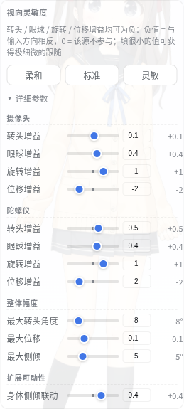

# look-params-simplify 用户验证

## 验证说明

- 验证对象：视向灵敏度面板的精简（删 3D 空间变换 / 眉毛联动 / 眼球形变联动）、位移增益默认 -2、眼球增益独立、以及「极小增益值是否真的生效」的核心修复。
- 环境/前置条件：生产 GUI `http://127.0.0.1:4180` 的任一 Live2D 视图（角色已加载即可；视线追踪开不开都能检查面板与位移）。客户端 bundle 已重建，若页面没自动热重载，**刷新一次页面**（旧版本保存的滑条值已随存储键升级作废，会回到新默认值）。

（上图即改版后的「详细参数」：摄像头 / 陀螺仪各 4 条增益，已无 3D 空间变换、眉毛联动、眼球形变联动。）

## 验证项

| 验证步骤 | 预期结果 | 实际结果 | 状态 | 备注/证据 |
| --- | --- | --- | --- | --- |
| 打开 Live2D → ⚙ → 视向灵敏度 → 展开「详细参数」 | 只剩 4 组：摄像头（转头/眼球/旋转/位移增益）、陀螺仪（同 4 条）、整体幅度（最大转头角度/最大位移/最大侧倾）、扩展可动性（身体侧倾联动）；**没有**「3D 空间变换」组，也没有「眉毛上下联动」「眼球形变联动」 | | 待验证 | |
| 把摄像头「转头增益」先填 `0.005`，再填 `0.1`（数字框可直接输入） | 两个值**有可见差异**：0.005 时头几乎不动，0.1 时能动一点点；输入框与右侧读数都能显示 0.005（不再被四舍五入成 0.01） | | 待验证 | |
| 看「位移增益」默认值，并开着视线追踪左右看 | 默认显示 `-2`；模型整体平移方向与幅度和旧版明显不同（反向、幅度更大，满偏约占屏宽 20%）。觉得太夸张就把位移增益调小或把「最大位移」调小 | | 待验证 | |

补充（可选）：把摄像头「眼球增益」调到 `0`、转头增益留 0.6 → 头部仍会转、眼球不再跟着甩；再调回 0.4 眼球恢复跟随——确认眼与头身已分开。

## 验证结论

待验证。

## 待跟进

无。
