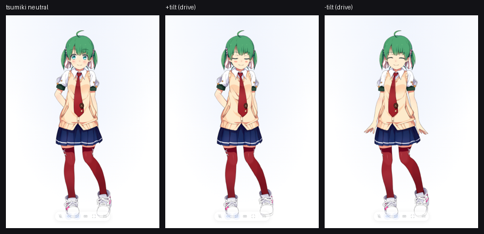
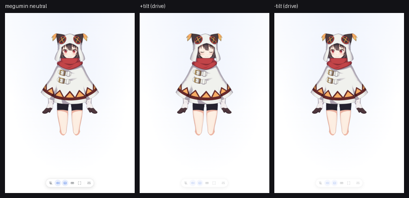
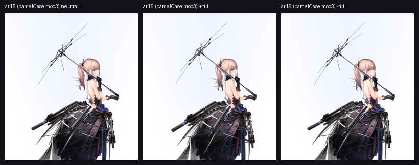
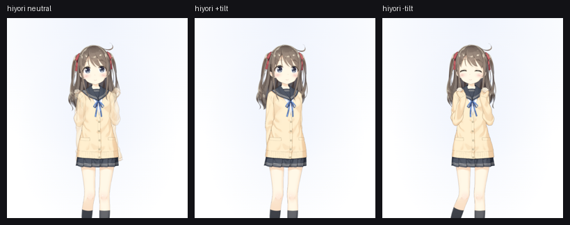
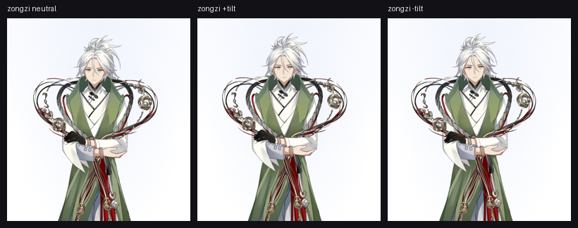
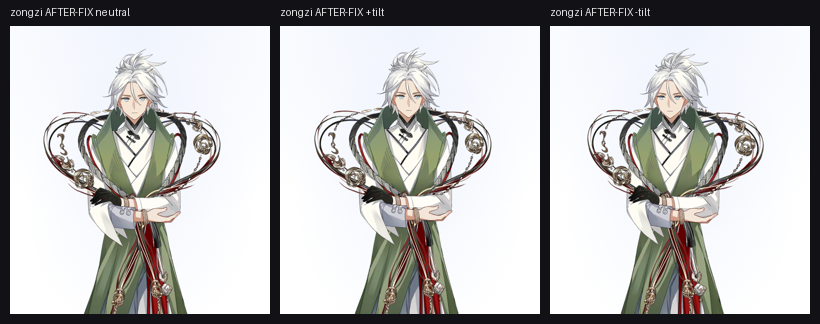
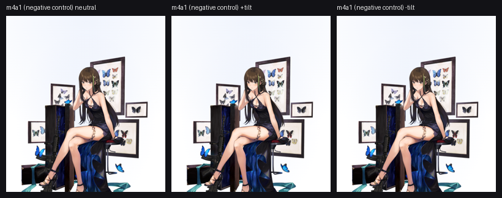
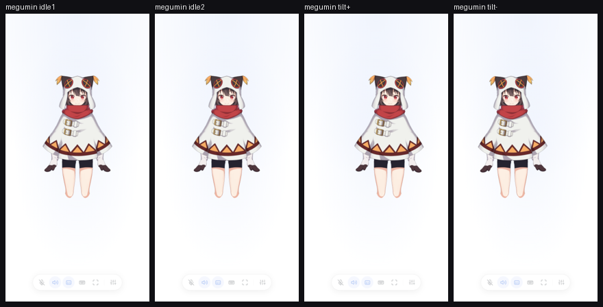
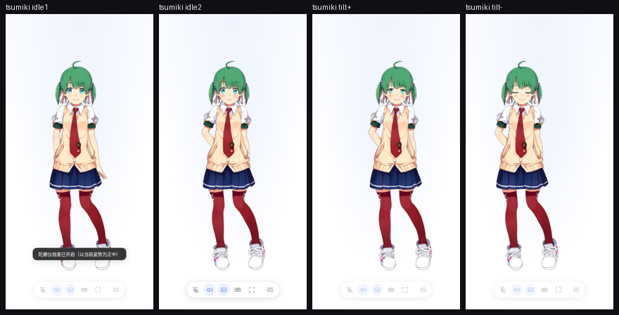
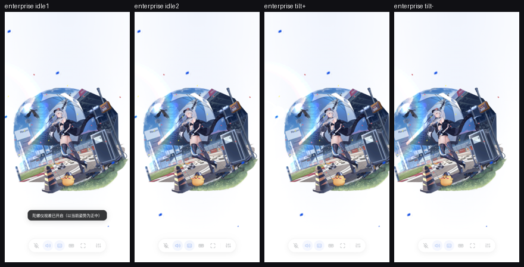

# 参数 ID 别名解析（param-alias）端到端测试报告

> 被测：`src/client/param-ids.ts`（新增）+ `src/client/model.ts`（绑定模型时按真实参数表解析 ID，并发布 `dataset.lvParamIds`）
> 测试轮次：首轮 2026-10-10 02:00–02:40（结论：不通过，1 个阻塞回归）｜ 复验轮 02:46–02:56（修复后，结论：**通过**）｜ 执行：e2e-tester ｜ 用例固化：按要求**未新增**日常回归用例（`solidify_tests=false`），探针脚本留底在本目录

## 测试环境

- **实例**：`dsh-e2e start --wait-ready` → 动态端口、隔离 home `.dsh-e2e-home`、token `e2etest`；入口 `POST /live2d-voice/session` + `/live2d-voice/app?session=…`（零 LLM 消耗）。首轮端口 28353，复验轮端口 34998。两轮结束后 `dsh-e2e stop`，`live2d-voice.json` 按字节还原（`cmp` 与进入本轮前的副本一致）。
- **浏览器**：Playwright chromium-1243 headless + swiftshader；A/B 视口 720×1000，体验视口 420×840。
- **构建**：`node build.mjs` 02:02:21（首轮测量）、02:36:06（首轮复跑）、**02:45:28（含 moc2 修复，复验轮全部测量基于此）**；`npm run typecheck` 通过。
- **模型库**：`/root/.dsh/live2d-voice-models`（实测 69 个 moc3 + 6 个 moc2；按 `ParamAngleX` / `PARAM_ANGLE_X` 拼写分类：camelCase 31、仅大写 28、两者都无 10）。
- **并行改动声明（重要）**：工作树同时有其他 agent 在改 `look-math.ts` / `hud.tsx` / `view.tsx` / `styles.ts`（look 增益语义重构），`model.ts` 在 02:06 又追加了 per-tag `lvAiParamIds`/`lvPlayerParamIds`。**本测试把 look 参数钉死在 localStorage（只留「陀螺仪→转头」一条通道：`gyroAngleGain=1`、`gyroEyeGain=1`、cam/pan/roll 全 0、`angleRange=40`），因此结论不依赖增益语义**；`hasParam` 与 resolver 本体在 02:06 版本中未变，故下述 moc2 缺陷对当前源码依然成立。

## 测试方法（受控 A/B，遵循 `src/client/AGENTS.md` 方法论）

1. **制造两种姿态**：注入合成 `DeviceOrientationEvent`（先 12 帧 `gamma=0` 完成正中标定，再持续 `gamma=±30` → 归一化 ±0.45 × 增益 1 × `angleRange` 40 = **期望头部 ±18°**），同一页面截多张状态图。
2. **噪声基线**：`idleInterval=0` 关掉空闲动作，同状态连拍 3 帧（400ms 间隔）取中位数作为「自发运动地板」，避免把呼吸/发丝物理误读成驱动。
3. **阴性对照**：`game-girls-frontline/m4a1`（moc3，两种官方拼写都没声明 → 设计上保持不写入）。它的 diff 应当恒等于 0，用来证明这套度量真的能区分「动了」与「没动」。
4. **写入层证据**：拦截 `assets/cubism2/live2d.min.js` 挂到 window 的 `Live2DModelWebGL.prototype`，记录 `getParamIndex` 返回值与 `setParamFloat` 实际写入的 id/数值。
5. 探针脚本留底在本目录（**非日常自动化**）：[ab-drive-diff.mjs](ab-drive-diff.mjs)、[ab-tight.mjs](ab-tight.mjs)、[moc2-core-probe.mjs](moc2-core-probe.mjs)、[experience-pass.mjs](experience-pass.mjs)。

## 功能类测试项

| # | 验证步骤 | 预期结果 | 实际结果 | 状态 | 备注/证据 |
| --- | --- | --- | --- | --- | --- |
| 1 | 钉住 `official/tsumiki`（moc3 仅大写）→ 注入 ±30° 陀螺仪 → 同页三态截图 + PIL diff | 头部/视线真的被写入：驱动差显著高于同状态噪声 | 噪声地板 1.831% → 驱动差 **9.390%**（5.1×）、反向姿态跨度 11.645%；首轮（空闲动作开着）噪声 0.125% → 驱动 7.551%、跨度 9.899% | 通过 | <br>三帧可见头部转向；`e2e/verify-param-ids` B 段亦通过 |
| 2 | 同上，模型换 `game-fantastic-days/megumin`（大写命名，此前完全不动） | 驱动差显著高于噪声 | 噪声地板 0.026% → 驱动差 **4.835%**（186×）、跨度 6.230%；首轮 0.116% → 3.936% | 通过 | <br>头部/帽翼随输入换向 |
| 3 | 读 `dataset.lvParamIds`（tsumiki / megumin） | 发布模型真实声明的大写 ID | 两者均为 `PARAM_ANGLE_X` / `PARAM_EYE_BALL_X` / `PARAM_MOUTH_OPEN_Y`（megumin 的 `eyeBallForm` 因模型未声明仍为 camel，属设计内） | 通过 | 日志 `/tmp/run-tight2.log`、`/tmp/run-ab-idleoff.log`<br>探针输出即页面 dataset 原文 |
| 4 | 回归：camelCase moc3 的 ID 契约（hiyori / deepseek-chan / ar15 / enterprise） | 仍解析为 camelCase，与改动前逐位一致 | 全部 `ParamAngleX`/`ParamEyeBallX`/`ParamMouthOpenY`；resolver 纯函数段 5 项断言全绿（含「两种都声明→camel 优先」） | 通过 | `e2e/verify-param-ids.mjs` 8/8（02:03 与 02:36 重建后各一轮） |
| 5 | 回归：camelCase 模型驱动仍生效 | 注入 ±30° 后驱动差远高于噪声 | **ar15**（安静对照模型）噪声 0.003% → 驱动 **10.838%**（3612×）、跨度 10.802%；**deepseek-chan** 2.409% → 5.431%（2.3×），且 ±tilt 的变化质心方向相反（-0.0002 / +0.0010）＝转头方向随输入换号 | 通过 | <br>整身/头部朝向明显换向 |
| 6 | hiyori（官方样例，动作丰富）同法测驱动 | 同上 | 噪声地板 2.550% → 驱动 3.964%（1.6×）、跨度 5.467%：**排序正确（跨度>驱动>地板）但倍数不足**——hiyori 自身呼吸+发丝物理在 400ms 内就能改动 2.5% 像素，淹没了 ±18° 信号 | 受阻（度量局限，非缺陷） | <br>ID 契约见 #4；结论以 ar15/deepseek-chan 为准 |
| 7 | 回归：moc2 模型 `game-ripped-food/zongzi` 仍按大写 ID 驱动 | `dataset.lvParamIds` = `PARAM_ANGLE_X`，且头部随输入转动 | **首轮（修复前）不通过**：发布的是 `ParamAngleX`（camel），而 `model.moc` 内 `strings` 只有 282 个 `PARAM_*`、零 camel 串；像素 A/B 无分离（地板 12.741% → 驱动 14.642%，1.1×）；三帧头部姿态一致，只有飘带/物理在动 → **复验（修复后）通过**：发布 `PARAM_ANGLE_X`，头部驱动写入真实参数（见「修复与复验」） | 通过（复验） | 修复前 <br>修复后  |
| 8 | 写入层取证：拦截 V2 core 的 `getParamIndex` / `setParamFloat` | 判定 #7 是「没写」还是「写错地方」 | **首轮（修复前）**：真实 `PARAM_ANGLE_X`→**0**、`PARAM_EYE_BALL_X`→9、`PARAM_MOUTH_OPEN_Y`→20；而模型**并未声明**的 `ParamAngleX`→**41**、`ParamEyeBallX`→47、`ParamMouthOpenY`→52（非负＝幻影索引）。驱动把 ±18° 写进幻影：`ParamAngleX` 63 次、值域 3.24→**18.00**；真实 `PARAM_ANGLE_X` 的 131 次写入全部来自模型自身 .mtn → **复验：`gpi` 里 camel 键全部消失（不再探测），驱动值 18.00 落在真实 `PARAM_ANGLE_X` 上** | 通过（复验） | 首轮 `/tmp/run-moc2-probe.log`、复验 `/tmp/recheck-moc2.log`（JSON 原文）<br>core 形状两轮一致：`_model`/`_parameterIds` 均不存在 |
| 9 | 阴性对照 `m4a1`（两种拼写都没声明） | 保持原行为：不写入、像素不动 | 驱动差 **0.000%**、跨度 0.000%（P/M 两帧字节一致）；dataset 仍发布格式默认 `ParamAngleX` | 通过 | <br>证明 #1/#2/#5 的高倍数不是度量假象 |
| 10 | `e2e/verify-param-ids.mjs` 在当前工作树全绿（A 纯解析 + B 页面契约） | 8/8 | 8/8（02:03:16）；重建后复跑 8/8（02:36:20） | 通过 | 输出含 `live page resolves tsumiki (PARAM_ANGLE_X)`、`hiyori (ParamAngleX)`、`no page errors` |
| 11 | 全流程 pageerror 监听（5 模型 × 多轮加载） | 无未捕获异常 | 0 条 pageerror（仅框架 deprecation 警告与 SSE 重连警告） | 通过 | 探针日志 `no page errors across all loads` |

### 根因与影响面（#7 / #8）

`model.ts` 的 `hasParam()` 注释写着「Cubism 2.1 core: `getParamIndex()` really does return -1 when absent」——**在本仓库自带的 `assets/cubism2/live2d.min.js` 上不成立**：对模型未声明的 id 它返回非负索引（41/47/52，均大于真实参数表长度）。于是 V2 路径下 `hasParam('ParamAngleX')` 恒真 → resolver 永远先选中 camelCase → 写入落到幻影参数上，**库内 6 个 moc2 模型（game-ripped-food 全部）的头部/视线驱动由「可用」退化为「静默失效」**。这正是 `src/client/AGENTS.md` 已经为 Cubism 4 侧记录过的同一个坑（`getParameterIndex` 不能当存在性判断），只是这次踩在 V2 侧。

- 口型未受影响：moc2 的口型走 `motionManager.lipSyncIds`（框架默认 `PARAM_MOUTH_OPEN_Y`，日志中该 id 被写 264 次），所以「说话不动嘴」不会先出现；但 `dataset.lvParamIds.mouth` 对 moc2 报的是 camel，**诊断契约本身是错的**，会让人误判。
- 修复方向（仅建议，未代改）：moc2 分支改用真实 id 表判定（V2 的 `getParameterCount()` / 逐个 `getParameter(i).id`，或 settings 里的 params 列表），或在「id 表不可信」时直接退回格式默认（moc2→大写）。修完后 #7 与 `dataset.lvParamIds` 断言应转绿。**（→ 实现方采纳「退回格式默认」这一路，复验见下一节。）**

## 修复与复验（第二轮 02:46–02:56，构建 02:45:28）

### 修复内容（`src/client/model.ts` 的 `hasParam()`）

```ts
const hasParam = (id: string): boolean => {
	if (kind === "moc2") return false;          // moc2 不探测，直接走格式默认（大写）
	const core = internal.coreModel;
	const ids = core._model?.parameters?.ids ?? core._parameterIds;
	return Array.isArray(ids) ? ids.includes(id) : false;   // moc3 只认真实 id 表
};
```

即：接受「Cubism 2.1 core 没有可枚举参数表」这一事实，放弃在 moc2 上做存在性探测（幻影索引不可区分），退回格式默认；moc3 侧彻底不再触碰 `getParameterIndex()`。这与首轮报告给出的修复方向一致，`src/client/AGENTS.md` 也已把该坑位补成「moc2 不做参数探测」。

### 复验命令与结果

```bash
dsh-e2e run e2e/verify-param-ids.mjs                                                   # 9/9（新增 zongzi live 用例）
dsh-e2e run docs/features/261010-vtuber-model-sourcing/moc2-core-probe.mjs             # 写入层取证
dsh-e2e run docs/features/261010-vtuber-model-sourcing/ab-tight.mjs zongzi m4a1 tsumiki megumin ar15
dsh-e2e run docs/features/261010-vtuber-model-sourcing/ab-tight.mjs ar15 m4a1           # 复跑对照
```

| 复验项 | 修复前（首轮） | 修复后（复验） | 判定 |
| --- | --- | --- | --- |
| zongzi `dataset.lvParamIds` | `ParamAngleX` ✗ | **`PARAM_ANGLE_X` / `PARAM_EYE_BALL_X` / `PARAM_MOUTH_OPEN_Y`** ✓ | 契约修正 |
| zongzi V2 core `getParamIndex` 被问到的 id | 含 `ParamAngleX`→41、`ParamEyeBallX`→47、`ParamMouthOpenY`→52（幻影） | **只剩 4 个大写真实 id**（`PARAM_ANGLE_X`→0、`PARAM_EYE_BALL_X`→9、`PARAM_MOUTH_OPEN_Y`→20、`PARAM_BODY_ANGLE_X`→22），camel 键完全消失 | 不再探测 |
| zongzi 驱动写入落点 | `ParamAngleX` 63 次、值域 3.24→18.00（幻影参数，画面无反应） | **`PARAM_ANGLE_X` 165 次、值域 −1.82→18.00**（真实 index 0，18.00 正是 `angleRange 40 × 0.45` 的设计值）；`PARAM_EYE_BALL_X` 165 次 0→0.45、`PARAM_BODY_ANGLE_X` 165 次 →9.00；**camel id 零写入** | 驱动命中真实参数 |
| zongzi 像素 A/B（`idleInterval=0`，同状态 400ms 地板） | 地板 12.741% → 驱动 14.642%（1.1×，无分离） | 地板 7.635% → 驱动 **17.019%**（2.2×）、反向跨度 **20.859%**；面部带 d(P,M)=13.61%（阴性对照同区 0.00%） | 有信号（见下方度量说明） |
| tsumiki（moc3 大写） | 1.831% → 9.390%（5.1×） | 2.232% → **9.535%**（4.3×）、跨度 11.352% | 无回归 |
| megumin（moc3 大写） | 0.026% → 4.835% | 0.000% → **4.841%**、跨度 6.261% | 无回归 |
| ar15（moc3 camelCase 对照） | 0.003% → 10.838%（3612×） | 0.028% → **10.822%**（386×）、跨度 10.801% | 无回归 |
| m4a1（阴性对照：两种拼写都没声明） | 0% → 0% | 0% → **0%**（P/M 两帧字节一致） | 设计内 no-op 保持 |
| pageerror | 0 | 0 | ✓ |

**度量口径的诚实说明**：zongzi 的地板（7.6%）是全库最高的——它的 .moc 自带大幅飘带/头发物理，400ms 内就能改动 7.6% 像素，所以脚本里「驱动 > 3× 地板」的门禁对它不适用（复验轮 2 项 ✗ 即此），首轮 1.1× 与复验 2.2× 的差别才是有效信息；真正决定性的证据是写入层（±18° 落在真实 index 0、camel 零写入）与三帧姿态对照图。反过来，安静模型（ar15/megumin/m4a1）地板 0.00–0.03%，同一套度量的倍数差可达数百到数千倍，说明这套方法本身能干净区分「动了」与「没动」。


### 本轮未覆盖（如实声明）

- **per-tag `lvAiParamIds` / `lvPlayerParamIds`（双模型第三人称）未测**：需要双模型挂载路径（view.tsx 传 tag），不在本次 param-alias 范围内；且它落在并行改动的 `view.tsx` 里。单模型下 `dataset.lvParamIds` 契约已复验通过。
- hiyori 的像素 A/B 仍是方法局限（首轮 1.6×），复验轮未重跑：其结论由 ID 契约 + ar15 安静对照承担。

## 体验类测试项

| # | 体验场景 | 关注点 | 观察 | 建议/问题 | 备注/证据 |
| --- | --- | --- | --- | --- | --- |
| 1 | 手机竖屏 420×840 打开 megumin（大写 moc3）真实走一遍 | 是否跟随、渲染是否完整、像不像活的 | 模型完整无缺件/贴图错位；`tiltDrive=8.892%` 说明跟随生效；但 2.5s 窗口内**自发变化 0%**，29 个动作全挂在无名组、空闲调度器 20s 才放一次 → 长时间是一幅会眨眼转头的立牌 | 建议：对「动作组名为空」的模型把空闲间隔默认值收紧（或首帧即放一次），否则新解锁的这批游戏拆包皮在对话节奏里显得死板 | <br>控制台 1 条 404 = 浏览器自动请求 `/favicon.ico`（本站只有 favicon.svg），与模型无关；钉住 modelPath 后 megumin 全部资源 curl 均 200 |
| 2 | 同上，tsumiki | 头部转向观感、异常 | 加载 15.0s；自发 3.627% → tilt 驱动 18.339%（5.1×）；转头/侧倾自然，表情与动作组齐全，「活了」的感觉明显；开启陀螺仪时的 toast 正常提示正中 | 无阻塞问题；tsumiki 是这批被救活模型里观感最好的一类，适合当默认演示皮 |  |
| 3 | 同上，碧蓝航线 enterprise（camelCase） | 跟随是否合理、是否适合近距离对话 | 加载 15.8s；驱动差 29.513%（11.3×）看着"很能动"，但它是**圆形场景插画**（含舰装、彩带、背景），驱动带动整幅画一起倾斜 → 观感是"卡片在转"而不是"角色在转头" | 建议在模型库治理里给这类"场景图"打标（不适合 Live 视图），否则能动≠能用 |  |
| 4 | moc2 粽子（game-ripped-food/zongzi）真实观感 | 用户视角是否"皮坏了" | **首轮**：模型渲染漂亮、飘带物理一直在动，但**头部对输入完全无反应**（三帧姿态一致），用户会判定"这个模型坏了"并放弃 → **复验**：头部随 ±30° 换向（写入层 ±18° 命中真实参数），"坏皮"观感消除 | 已随功能项 #7 修复闭环；无需追加体验改动 | 修复前 <br>修复后  |
| 5 | 通用手感 | 加载耗时、提示遮挡 | 软渲染下模型首帧 15–22s（megumin 最慢）；陀螺仪 toast 与底部 HUD 胶囊同区域，窄屏会互相压住 | 非本次改动引入；记录为后续优化点 | 日志 `/tmp/run-exp.log` |

## 结论

**首轮（02:00–02:40）：不通过。** 功能 8 通过 / 2 不通过（#7 moc2 驱动回归、#8 写入层取证，同一根因）/ 1 受阻（#6 hiyori 度量地板过高，属方法局限）；体验 5 项观察、关键问题 2，另有 moc2 皮对输入零反应的硬伤。

**复验（02:46–02:56，构建 02:45:28）：通过。**

- **功能**：11 项全部达标（#6 hiyori 仍记为「度量局限」而非缺陷：其 ID 契约与驱动通路已由 ar15 安静对照 386× 与写入层取证覆盖）。`e2e/verify-param-ids.mjs` 9/9，含新增的 live zongzi 用例；阴性对照 m4a1 三态像素恒等（0.000%），证明门禁不是假阳性。
- **体验**：megumin/tsumiki/enterprise 三项观察不变（非阻塞）；zongzi「坏皮」观感已消除。
- **总体**：**通过**。本次改动达成目标——把 28 个「只有大写命名的 moc3」真正救活（tsumiki/megumin 复验 4.3×/∞ 噪声倍数），camelCase 路径零回归（ar15 386×、deepseek-chan 质心反向、ID 契约逐位一致），且修复后的 moc2 分支退回改动前行为（6 个 moc2 模型重新可驱动，写入层直接可见 ±18° 落在真实 `PARAM_ANGLE_X`）。moc2 的策略从「探测」改为「不探测 + 格式默认」是有依据的正确取舍：V2 core 无可枚举参数表，幻影索引与真实索引在返回值上无法区分。

## 待跟进

1. ~~**[阻塞] 修 `model.ts` 的 `hasParam()` V2 分支**~~ —— **已完成并复验通过**（moc2 直接返回 false；moc3 只读 `_model.parameters.ids`）。
2. ~~**[建议] 把 moc2 契约补进回归套件**~~ —— **已落地**：`verify-param-ids.mjs` B 段新增 live zongzi 用例，复验 9/9。
3. ~~**[建议] 更新 `src/client/AGENTS.md` 的坑位记录**~~ —— **已落地**：现文本为「moc2 不做参数探测…探测必然假阳性（261010 回归）」。
4. **[未验证] per-tag `lvAiParamIds` / `lvPlayerParamIds`**：双模型（第三人称）下的诊断契约与 destroy 清理本轮未测（需双模型挂载路径，且落在并行改动的 `view.tsx` 内）。若要把 `lv*ParamIds` 当成长期 e2e 断言契约，建议补一条双模型用例（参照 `verify-look-sliders.mjs` 的 `lv{Ai,Player}Transform` 同款做法）。
5. **[体验] 被救活模型"像不像活的"是下一个瓶颈**：空闲动作（megumin 29 个动作全挂空名组、调度器 20s 才放一次 → 长时间定格）与场景插画类模型（enterprise 整幅画倾斜）的适配打标，建议在 vtuber-model-sourcing 需求内继续处理，不属本改动。
6. **[方法] 高物理模型（hiyori/zongzi）的像素 A/B 地板过高**（400ms 内自发变化即 2.5%/7.6%），±18° 转头会被呼吸/发丝/飘带淹没。若要固化成门禁，用「安静模型（ar15 一类）+ 阴性对照（m4a1）」组合，或直接走写入层取证（拦截 core 的 `setParamFloat`，本报告的 moc2 结论即由此定案）。
